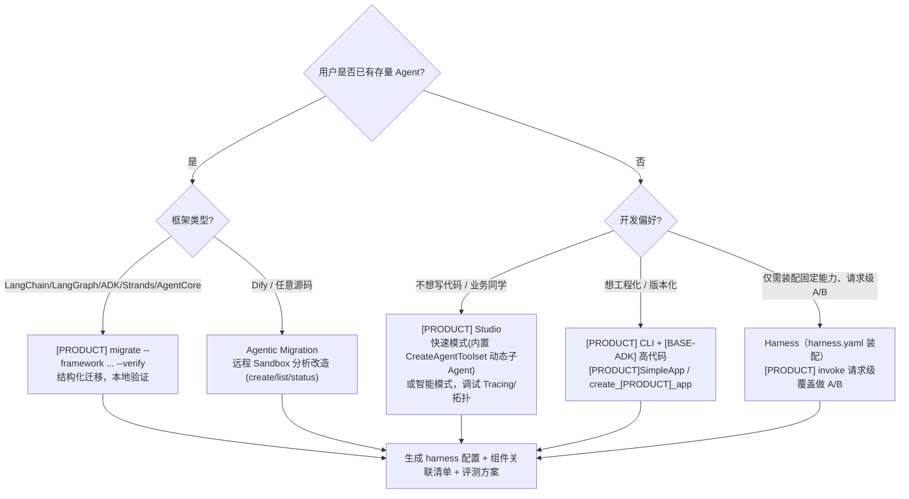
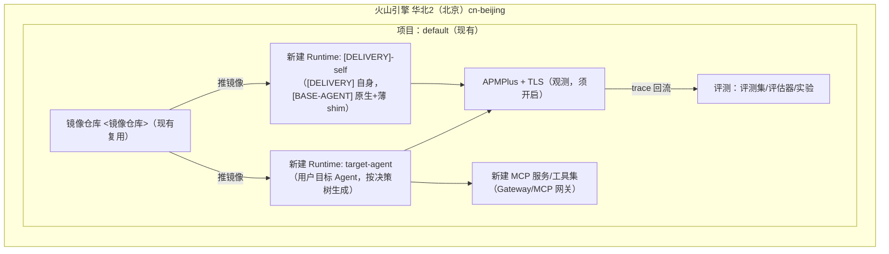

# 01 — [PRODUCT] Agent 开发 [DELIVERY] 整体架构设计

> 版本：v0.2（设计稿，未部署/未测试/未接通）
> 撰写日期：2026-09-18
> 修订日期：2026-09-18（v0.2：按 `docs/[BASE-PAIR]/05-[BASE-AGENT]-as-base-verification.md` 核验结论重定底座；详见文末「修订记录」）
> 证据基线：`docs/[BASE-PAIR]/05-[BASE-AGENT]-as-base-verification.md`（核心）、`docs/volcengine-official/[SHARD-1]~4-results.md`、`docs/[BASE-PAIR]/01~04*.md`
> 状态声明：本文档为**纯设计**。当前未核验凭据、未核验实际项目资源、未接通观测服务。凡未接通项一律标注「待核验」，不得当作已可用。

---

## 0. 设计前提与证据基线（必读）

本设计不是从零想象，全部关键决策均有证据支撑。下表列出贯穿全文的事实锚点。**结论分级严格区分**：未发现 / 缺乏原生适配 / 不能直接传入 LlmAgent / 可以自定义适配——禁止把「未发现」等同「不存在/闭源」。

| 事实 | 结论分级 | 证据 |
|---|---|---|
| [BASE-ADK] `Agent` 继承 `google.adk.agents.LlmAgent`，依赖 ADK event/session/tool 抽象 | 已核验 | `docs/[BASE-PAIR]/02-[BASE-ADK]-verification.md` 声明 a |
| [BASE-AGENT] 是独立框架，有自己的 agent loop（`run_agent.AIAgent` + `agent/conversation_loop.run_conversation`）/ SQLite 状态 / 工具系统，**不继承 LlmAgent** | 已核验 | `05-[BASE-AGENT]-as-base-verification.md` §1b |
| [BASE-AGENT] **不能直接把 `AIAgent` 当作 [BASE-ADK] 的 `LlmAgent` 传入 `create_[PRODUCT]_app(root_agent=...)`** | **不能直接传入 LlmAgent**（需 wrapper，方案 B） | `05-...verification.md` §8 分级表 |
| [BASE-ADK] 代码中**未发现** [BASE-AGENT] 原生适配层（code search `[BASE-AGENT]` 零结果） | **未发现 / 缺乏原生适配，需自建适配层**（不是「闭源/不存在」） | `02-[BASE-ADK]-verification.md` 声明 c；`05-...verification.md` §9.4 |
| **Runtime API 层不强制镜像基于 [BASE-ADK]**：CreateRuntime 只要求 `ArtifactType=image/public_image` + `ArtifactUrl=<镜像:tag>` + `Envs` + 资源规格 + 鉴权；但容器须满足**层 1**（监听端口默认 8000 / 启动命令 `Command` / 健康检查 / KeyAuth 或 JWT / 资源网络 IAM）。`/run` `/run_sse` `/sessions` `/ping` 是 [BASE-ADK]/ADK **应用层**路由（SDK 最精简 `[PRODUCT]SimpleApp` 不含前三者），非 Runtime 强制（见 §4.1 三层契约） | **可以自定义适配**（[BASE-AGENT] 原生进程需经薄 FastAPI shim 满足层 1；层 2 按需补） | `05-...verification.md` §3c；`[SHARD-1]-results.md` CreateRuntime |
| `create_[PRODUCT]_app(harness_extension=...)` 的契约**极窄**：扩展对象仅需实现 `sidecar_status_payload()`（返回 Mapping）与 `close()`；挂 `/web/harness-sidecar/status` | 已核验 | `05-...verification.md` §4 |
| [BASE-AGENT] `mcp_serve.py` 是 **messaging bridge（10 个工具：conversations_list/messages_read/events_poll/messages_send 等）**，**不是完整 agent loop，不能当 [DELIVERY] 的 agent RPC**（无「发 prompt→跑 loop→回答案」语义） | 已核验 | `05-...verification.md` §2 |
| [BASE-AGENT] 自进化 = 后台审查 Fork + 自主记忆管理（MEMORY.md/USER.md）+ 自主技能创建（SKILL.md），是**原生能力**，非模型权重更新；**不需要移植到 [BASE-ADK]** | 已核验 | `01-[BASE-AGENT]-agent.md` §3.6；`05-...verification.md` §1c（gateway 常驻进程） |
| 自进化边界 = 自动学习并提出改进提案，**人工批准后才生效**；评测基线 `baseline_locked` 不可被进化改写 | 设计约束 | 本文 §4.3；`02-eval-driven-flow.md` Step2 |
| 开服地域 cn-beijing / cn-shanghai；资源创建后不可换地域；**API Version 统一 `2025-10-30`** | 已核验 | `[SHARD-1]-results.md` 服务地址/公共参数 |
| Endpoint：普通接口 `[PRODUCT].cn-beijing.volcengineapi.com`；**InvokeTool / AsyncExecCommand 用 `<INTERNAL_HOST>.com`** | 已核验 | `[SHARD-1]-results.md` 服务地址；InvokeTool/AsyncExecCommand 页 |
| ToolType 取值：`All-in-one / Skill / Private / CodeEnv / PersonalAssistant / VibeSkill` | 已核验 | `[SHARD-1]-results.md` CreateTool/UpdateTool；发布历史 2025-12-15、2026-02-28、2026-07-10 |
| 观测 = APMPlus（指标/链路）+ TLS 日志；在线评测必须开启观测；**日志字段已核验 10 个**；**埋点字段已通过浏览器 DOM 补读成功**：[PRODUCT] 9 个 `gen_ai.*` Span 属性 + 2 个 Metrics（latency/count，维度 error_type/operation_name/operation_type）；[BASE-ADK] 4 个 Span 名（invocation/invoke_agent{name}/call_llm/execute_tool{name}）+ 通用类 15 + LLM 类 23（含 gen_ai.usage.* token 五项）+ Tool 类 9 字段 | 已核验（日志字段来自 shard4 附录 A；埋点字段来自 browser-gap-results.md 任务1） | `shard4-results.md` 附录 A；`browser-gap-results.md` 任务1 |
| 数据回流：线上 Trace 批量导出至评测集，**上限 100000 条/任务**，仅回流新数据 | 已核验 | `shard4-results.md` 数据回流页（附录 F） |
| 评测三件套 = 评测集 + 评估器 + 评测实验；线上 trace 可自动回流评测集 | 已核验 | `shard4-results.md` 评测中心概述；管理评测集/实验页 |

---

## 1. 三个必须先讲清的概念边界

### 1.1 [DELIVERY] 自身 vs [DELIVERY] 帮助设计的「目标 Agent」

本系统存在两个 Agent，必须严格区分：

| | **[DELIVERY] 自身（本系统）** | **目标 Agent（被设计对象）** |
|---|---|---|
| 角色 | 引导用户完成 Eval-driven 开发的「元 Agent」 | 用户最终要上线的业务 Agent |
| Harness | **[BASE-AGENT] 原生主循环（`AIAgent.run_conversation`）+ 薄 FastAPI shim 满足层 1**（方案 A，推荐）；Runtime 托管容器须满足层 1（§4.1） | **框架选择由用户决定，[DELIVERY] 只引导** |
| 部署 | 固定部署到华北2 default project | 由 [DELIVERY] 生成部署方案，用户确认后落地 |
| 复用证据 | `05-...verification.md` §7 方案 A；`[SHARD-1]-results.md` CreateRuntime | `docs/lark-supplements/doc01.md`「迁移：已有 LangChain/LangGraph/ADK/Strands/AgentCore 无需重写」 |

> 设计原则：[DELIVERY] **不替用户决定**目标 Agent 用什么框架，而是在 Step 3 用决策树引导用户在 Studio 低代码 / [BASE-ADK] 高代码 / Harness 无代码 / 存量迁移之间选择。
>
> **底座纠偏（v0.2）**：[DELIVERY] 自身的 agent loop 由 **[BASE-AGENT] 原生进程**承担，**不是**「[BASE-ADK] 主 + [BASE-AGENT] MCP sidecar」。[BASE-AGENT] 自带常驻 gateway 进程（`gateway/run.py` 的 `start_gateway()`/`GatewayRunner`，含 agent cache 与 cron），自进化是其原生能力。真正要补齐的是**在 [BASE-AGENT] 进程外加一层薄 shim，让它讲 [PRODUCT] Runtime 的 HTTP 协议**（鉴权 header、`/run` `/run_sse` `/invoke` `/ping`、session 语义），而不是把 [BASE-AGENT] 退化成 sidecar。证据：`05-...verification.md` §1c/§1d/§7。

### 1.2 设计时拓扑 vs 运行时 trace

这是两个**不同数据源**，严禁混用：

- **设计时拓扑（Design-time Topology）**：架构图中画出的「组件应该如何连接」——例如「目标 Agent 经 Gateway 调 MCP Toolset」。它来自 Step 3 的设计输出，是**计划态**。
- **运行时 trace（Runtime Trace）**：实际调用后从 **APMPlus trace + TLS 日志**取到的「实际发生了什么」——哪个 agent/Skill/MCP/知识库被调用、调用次数、时延、是否报错。它来自 Step 4 的观测取数，是**事实态**。

> 铁律（证据：`docs/lark-supplements/doc07.md` 观测 GTM「无侵入注入、AI 层与微服务同一条 trace」；`14-observability.md`）：
> 架构图里「测试调用了哪些组件」必须从可观测取数，**不能编造**。观测缺失只能标「未知 / 无数据」，**不能等同未调用**。

### 1.3 Eval-driven 是开发理念，不是模型训练

[BASE-AGENT] 自进化 = 运行时 prompt 层学习（写 MEMORY.md / 建 SKILL.md），**不改模型权重**。[DELIVERY] 据此把「进化」限定为：自动学习并提出改进提案 → **人工批准后才生效**。证据：`01-[BASE-AGENT]-agent.md` §3.6；`05-...verification.md` §1c（自进化是 [BASE-AGENT] 原生能力，见 `04-[BASE-AGENT]-self-evolution.md`）。

---

## 2. [DELIVERY] 系统架构图（Mermaid）

下图表达 [DELIVERY] **自身**的 harness 设计。实线=进程/协议内调用，虚线=sidecar/后台/人工流。

```mermaid
flowchart TB
    subgraph USER["开发者（用户）"]
        U[业务开发者]
    end

    subgraph WIZ["[DELIVERY] 自身（固定，部署到 [PRODUCT] Runtime）"]
        direction TB
        subgraph CORE["[BASE-AGENT] 原生进程（底座）"]
            AIA["AIAgent.run_conversation<br/>原生 agent loop"]
            GW["gateway 常驻进程<br/>start_gateway / GatewayRunner<br/>agent cache + cron"]
            SELF["原生自进化（非 sidecar）<br/>后台审查 Fork / 记忆 curation / 技能自主创建"]
        end
        SHIM["薄 FastAPI shim（自研）<br/>满足层1：端口/启动命令/健康检查/鉴权/POST /invoke<br/>层2 按需：/run /run_sse /sessions（不实现 /web/harness-sidecar/status）"]

        subgraph STEER["[DELIVERY] 引导编排层（运行在 [BASE-AGENT] loop 之上）"]
            S1["Step1 目标访谈<br/>grill-with-docs"]
            S2["Step2 验收标准<br/>+ 评测判断"]
            S3["Step3 架构设计<br/>组件选择 + Skill 调用"]
            S4["Step4 测试验证<br/>观测 trace 取数"]
        end

        subgraph SKILLS["[DELIVERY] 内置组件 Skill 库（skills/）"]
            SK_RT[[PRODUCT]-runtime]
            SK_SDK[[PRODUCT]-sdk]
            SK_VK[[BASE-ADK]]
            SK_AW[adk-workflow]
            SK_KB[[PRODUCT]-knowledge-base]
            SK_A2A[[PRODUCT]-a2a-registry]
            SK_SK[[PRODUCT]-skills]
            SK_GW[[PRODUCT]-gateway-mcp]
            SK_ID[[PRODUCT]-identity-permission]
            SK_GR[[PRODUCT]-guardrails]
            SK_EV[[PRODUCT]-evaluation]
            SK_OB[[PRODUCT]-observability]
            SK_SB[[PRODUCT]-sandbox]
            SK_MEM[[PRODUCT]-session-memory]
        end
    end

    subgraph PLATFORM["火山引擎 [PRODUCT] 平台（华北2 cn-beijing / default project）"]
        OBS["观测：APMPlus trace + TLS 日志"]
        EVAL["评测：评测集 / 评估器 / 评测实验"]
        KB["知识库 VikingDB"]
        A2AR["A2A Registry"]
        GW["Gateway / MCP"]
        RT["Runtime（[DELIVERY] 自身 + 目标 Agent，容器须讲 Runtime 运行时契约）"]
        SB["Sandbox"]
    end

    U -->|对话/批准| SHIM
    SHIM -->|映射到进程内| AIA
    AIA --> STEER
    S1 --> SKILLS
    S3 --> SKILLS
    S4 -->|真实取数| OBS
    SELF -->|重放会话| OBS
    EVAL -.->|评测结果| SELF
    SELF -->|提案 diff（pending）| U
    U -->|批准/驳回| SELF
    RT -->|托管镜像 + 端口/鉴权| SHIM
    RT --> OBS
    RT --> EVAL
    RT --> GW
    RT --> A2AR
    RT --> KB
    RT --> SB
```

> 说明（v0.2 重画）：
> - **[BASE-AGENT] 是底座，不是 sidecar**。`AIAgent.run_conversation` 是 [DELIVERY] 的对话与编排核心；自进化（`SELF`）是 [BASE-AGENT] 原生能力，运行在同一进程内，不是「[BASE-ADK] 主经 MCP 调 [BASE-AGENT]」。证据：`05-...verification.md` §1b/§1c/§7 方案 A。
> - **薄 shim** 是唯一自研的协议适配层：只须满足**层 1**（监听 8000/启动命令/健康检查/鉴权/`POST /invoke` 入口，把 `/invoke` 映射到进程内 `AIAgent.run_conversation(...)`）；层 2 的 `/run` `/run_sse` `/sessions` 仅在要兼容 [PRODUCT] CLI/Studio 时再补；**不需要** `/web/harness-sidecar/status`（那是 [BASE-ADK] `create_[PRODUCT]_app` 的 sidecar，[BASE-AGENT] 主路径不用它）。证据：`05-...verification.md` §3c 三层区分、§4。
> - **`[BASE-AGENT] mcp serve` 不进入本架构**。它是 messaging bridge（10 个工具，读 `state.db` + 向 telegram/discord 出站发消息），**不是**「发 prompt→跑 loop→回答案」的 agent RPC，不能当 [DELIVERY] 的 agent 调用入口。证据：`05-...verification.md` §2。
> - **`grill-with-docs` 需经 [DELIVERY] 适配层调度，不能原样运行**。`grill-with-docs/SKILL.md` 原文写「Call the Skill tool twice, for grilling and domain-modeling」——这是 Claude 等宿主的「Skill 工具」调用指令，**[BASE-AGENT] 原生没有「Skill tool」**。[BASE-AGENT] 通过 `~/.[BASE-AGENT]/skills/` 把 SKILL.md 作为系统提示加载；该指令在 [BASE-AGENT] 中必须由 [DELIVERY] 引导编排层（S1 节点所在层）翻译为：在对话循环内依次注入 `grilling/SKILL.md`（design tree 分轮访谈）与 `domain-modeling/SKILL.md`（维护 CONTEXT.md + ADR）两份子提示词流程。子 skill 路径已确认存在：`~/.agents/skills/grilling/SKILL.md`、`~/.agents/skills/domain-modeling/SKILL.md`。**三个 SKILL.md 可作为提示素材放入 [BASE-AGENT] skills 目录，但「调用 Skill 工具两次」必须经适配层翻译，不能声明原样加载即可运行。** 详见 `02-eval-driven-flow.md` §7。
> - **当前仅为设计**，未实测 [BASE-AGENT] 镜像在 [PRODUCT] Runtime 容器内的启动，也未实测 shim 的 SSE 事件格式与鉴权 header。

---

## 3. [DELIVERY] 自身组件清单与职责

[DELIVERY] 自身不是一个空 Agent，而是「**[BASE-AGENT] 原生主循环 + 薄 FastAPI shim + 引导编排 + 组件 Skill 库**」的装配体。

| 组件 | 在 [DELIVERY] 自身中的角色 | 证据 / 依据 |
|---|---|---|
| **[BASE-AGENT] 原生主循环（底座）** | [DELIVERY] 对话与编排核心；`run_agent.AIAgent` + `agent/conversation_loop.run_conversation`，承载四步引导状态机；自带常驻 gateway 进程与自进化 | `05-...verification.md` §1b/§1d/§7 方案 A |
| **薄 FastAPI shim（自研）** | 满足**层 1**（监听 8000/启动命令/健康检查/鉴权/`POST /invoke` 入口），把 `/invoke` 映射到进程内 `run_conversation`；层 2 `/run` `/run_sse` `/sessions` 按需补；不实现 `/web/harness-sidecar/status` | `05-...verification.md` §3c 三层、§7 方案 A |
| **[PRODUCT] Runtime** | 托管 [BASE-AGENT] 镜像的 OCI 容器；API 层不强制镜像必须基于 [BASE-ADK]/create_[PRODUCT]_app，框架无关，但容器须满足**层 1**（端口/启动命令/健康检查/鉴权/资源网络 IAM，见 §4.1 三层契约） | `05-...verification.md` §3c；`[SHARD-1]-results.md` CreateRuntime |
| **[DELIVERY] 引导状态机（Step1–4）** | 管理「目标→验收→架构→测试」四步的输入/输出/分支，运行在 [BASE-AGENT] loop 之上 | 本文 §1.3；`02-eval-driven-flow.md` |
| **组件 Skill 库（skills/）** | 把每个 [PRODUCT] 组件抽象为可加载 Skill，Step3 按需调用 | `doc01.md`「Skill 三种挂载方式：Hub slug / Space 全量 / space:skill 精准」 |
| **[BASE-AGENT] 原生自进化** | 后台审查 Fork、记忆 curation（MEMORY.md/USER.md）、技能自主创建/改进（SKILL.md）；**是 [BASE-AGENT] 原生能力，非 sidecar、非移植** | `01-[BASE-AGENT]-agent.md` §3.6；`05-...verification.md` §1c |
| **观测（APMPlus+TLS）** | [DELIVERY] 自身必须开启，否则 Step4 无法真实取数；在线评测必须开启观测 | `shard4-results.md` 开启观测页；在线评测必须开启 |
| **评测** | [DELIVERY] 自身用评测集回归「引导质量」；同时为目标 Agent 生成评测方案 | `shard4-results.md` 评测中心概述；管理评测实验页 |
| **Sandbox** | [DELIVERY] 让 Codex/沙箱在隔离环境生成/验证目标 Agent 代码与 Skill | `doc01.md` Sandbox 会话复用；`06-sandbox.md` |
| **会话记忆** | [DELIVERY] 跨会话记住用户的项目背景、未完成步骤 | `09-session-memory.md` 三层记忆 |
| **身份权限** | [DELIVERY] 自身受保护，不让任意用户驱动其写云资源 | `doc05/doc06`；生产需 UserPool+Cedar |
| **安全围栏** | 防止 [DELIVERY] 生成/执行越权指令 | `13-guardrails.md` |

---

## 4. [BASE-AGENT] 作为 [DELIVERY] 底座的适配方案

> 本节按 `docs/[BASE-PAIR]/05-[BASE-AGENT]-as-base-verification.md` 重写（v0.2）。**[DELIVERY] 底座 = [BASE-AGENT] 原生主循环**，不是「[BASE-ADK] 主 + [BASE-AGENT] MCP sidecar」。

### 4.1 结论先行

- **Runtime API 层不强制镜像必须基于 [BASE-ADK]/create_[PRODUCT]_app**：CreateRuntime 只要求 `ArtifactType=image/public_image` + `ArtifactUrl=<镜像:tag>` + `Envs` + 资源规格 + 鉴权（KeyAuth Header 或 CustomJwtAuthorizer）；`GetRuntime` 返回 `Command`（启动命令），说明镜像自带 entrypoint。**但这绝不等于「任意容器无约束」**——容器必须满足下述运行时契约，[BASE-AGENT] 原生进程需通过薄 FastAPI shim 实现这些契约端点。证据：`05-...verification.md` §3；`[SHARD-1]-results.md` CreateRuntime/GetRuntime。

#### Runtime 托管容器的三层契约（2026-09-18 二次核验：源码实证）

Runtime API 层不强制镜像必须基于 [BASE-ADK]/`create_[PRODUCT]_app`，但容器**不是「任意无约束」**。**关键修正**：此前把 `/run` `/run_sse` `/invoke` `/sessions` `/ping` 列为"Runtime 强制契约"证据不足——直接读 [PRODUCT]-sdk 与 [BASE-ADK]-python 源码后，它们分属三层（详见 `05-...verification.md` §3c）：

**层 1：Runtime 实际强制（有 API/源码证据）**

| 强制项 | 证据 |
|---|---|
| 监听 HTTP 端口（默认 8000，`0.0.0.0`） | [SHARD-1] `Port` 默认 8000；SDK `SimpleApp.run` 默认；[BASE-ADK] `run_[PRODUCT]_app` 默认 `HOST=0.0.0.0`/`PORT=8000` |
| 启动命令 `Command`（默认 `./run.sh`） | [SHARD-1] Tool `Command`；`GetRuntime` 返回 `Command` |
| 存在健康检查（错误码 `function_health_check_failed`） | [SHARD-1] 发布错误码 |
| 鉴权：KeyAuth（Header `ApiKeyName`）/ CustomJwt 二选一 | [SHARD-1] `AuthorizerConfiguration` |
| 资源/网络/IAM/Envs | [SHARD-1] `CpuMilli/MemoryMb/...`、`NetworkConfiguration`、`RoleName`、`Envs` |
| 框架无关（不强制 [BASE-ADK]/ADK） | [SHARD-1] Runtime 概述 |

> 层 1 中**两点待 POC**（证据不足，不写"必须实现"）：① Runtime 网关**具体探活路径**（`/ping` vs `/health`，[SHARD-1] 未写明）；② **调用转发路径**（`/invoke` vs `/run`）。

**层 2：[BASE-ADK]/SDK 应用层可选兼容路由（非 Runtime 强制）**

反证：SDK 最精简 `[PRODUCT]SimpleApp` 只注册 `GET /ping` `/health` `/readiness` `/liveness` + `POST /invoke`，**无 `/run` `/run_sse` `/sessions`**（`simple_app.py` L40-46）。故：

- `/run` `/run_sse` `/sessions` —— ADK `AdkWebServer`/[BASE-ADK] dynamic 路由，是 ADK 约定，SDK 最精简应用不含；
- `/invoke` —— SDK 最小调用端点（接近层 1），但 AgentServerApp 注释明写 "Compatibility route for [PRODUCT] CLI invoke"；
- `/ping` —— [BASE-ADK] 固定自省路由（返回 `{"status":"ok"}`），兼作身份豁免路由；**不证明它是 Runtime 网关探活路径**；
- `/web/agent-info` `/web/agent-draft` `/web/search` `/web/agent-graph` —— [BASE-ADK] Studio/拓扑自省；
- `/web/harness-sidecar/status` —— [BASE-ADK] harness_extension，**仅当 `harness_extension is not None` 才注册**。

**层 3：[DELIVERY] 自研业务 API（设计选择）**

- 薄 shim **必须**实现层 1（端口/启动命令/健康检查/鉴权/`POST /invoke` 入口）；
- `/run` `/run_sse` `/sessions` **按需**补（仅当要兼容 [PRODUCT] CLI/Studio 调试工具链）；
- **不需要** `/web/harness-sidecar/status`（[BASE-AGENT] 主路径不用 `create_[PRODUCT]_app`）；
- [DELIVERY] 业务路由（Step1-4 引导状态机、评测、审批队列、草稿 CRUD）见 `frontend/03-api-integration.md` §2.1。

- **[BASE-AGENT] 不能直接把 `AIAgent` 当 [BASE-ADK] 的 `LlmAgent` 传入** `create_[PRODUCT]_app(root_agent=...)`——`AIAgent` 是 [BASE-AGENT] 自有类，不继承 google.adk 的 `BaseAgent`。这是「不能直接传入 LlmAgent」，**不是「[BASE-AGENT] 不能上 Runtime」**。证据：`05-...verification.md` §8 分级表。
- **`[BASE-AGENT] mcp serve` 不能当 [DELIVERY] 的 agent RPC**：它是 messaging bridge（10 个工具，读 `state.db` + 向平台出站发消息），无「发 prompt→跑 loop→回答案」语义。要驱动 [BASE-AGENT] 思考，必须用 `AIAgent.run_conversation`（进程内）或 gateway 的 HTTP surface。证据：`05-...verification.md` §2。
- **`harness_extension` 契约极窄**：仅需 `sidecar_status_payload()`（返回 Mapping）+ `close()`，不是完整 MCP 路由或自进化契约。证据：`05-...verification.md` §4。

### 4.2 方案 A（推荐起步）：[BASE-AGENT] 原生进程 + 薄 FastAPI 协议 shim

- **做法**：镜像里跑 [BASE-AGENT]（`[BASE-AGENT]` / `[BASE-AGENT]-agent`，常驻 gateway），另写一个小 FastAPI 层满足**层 1**（监听 8000/启动命令/健康检查端点/鉴权透传/`POST /invoke` 调用入口，把 `/invoke` 映射到进程内 `AIAgent.run_conversation(...)`）；层 2 的 `/run`、`/run_sse`、`/sessions` 仅在需要兼容 [PRODUCT] CLI/Studio 时再补；**不需要** `/web/harness-sidecar/status`。
- **优点**：
  - 完全保留 [BASE-AGENT] 原生 loop、工具、skills、多平台 gateway、自进化——**[BASE-AGENT] 是真正的底座，未被替换**。
  - 不要求 [BASE-AGENT] 继承 `LlmAgent`/`BaseAgent`，绕开「不能直接传 LlmAgent」的问题。
  - Runtime 侧只要 `ArtifactUrl=<自己的镜像>` + `Envs` + KeyAuth 即可，容器须满足层 1（端口/启动命令/健康检查/鉴权），层 2 路由按工具链需要选做。
- **缺点 / 工作量**：
  - 需要自己实现层 1 细节（鉴权 header、健康检查端点、`/invoke` 入参出参），以及按需复刻层 2 的 `/run_sse` SSE 事件格式——这是 ADK/SDK 应用层约定，**不是 Runtime 网关强制**。
  - [BASE-AGENT] 的 session 模型（`state.db`）与调用方 `user_id`/`session_id` 需对齐。
  - **不给出无依据的行数估算**。工作量以"满足层 1 + 按需复刻层 2 路由语义"为准，具体行数待 POC 实测。
- **待验证点**：
  1. Runtime 网关**具体探活路径**（`/ping` vs `/health`）与**调用转发路径**（`/invoke` vs `/run`）、鉴权 header 名（`ApiKeyName` 自定义）——需用一次真实 CreateRuntime + 看 `FailedLogFileUrl`/webshell 验证（**层 1 待 POC 两点**）。
  2. [BASE-AGENT] `api_server` surface（gateway/run.py 里的 `api_server`）对外协议是否已接近可用，可减少 shim 工作量（本次未深读其路由表，**待验证**）。
  3. `run_conversation` 是否支持流式回调直接转 SSE（证据里有 `stream_delta_callback`/`thinking_callback` 等回调钩子，**倾向支持**，待实测）。

### 4.3 方案 B（备选）：[BASE-AGENT] 包成「类 BaseAgent」wrapper，复用 [BASE-ADK] 的 create_[PRODUCT]_app

- **做法**：写一个 `[BASE-AGENT]BaseAgentAdapter`，实现 `BaseAgent` 的最小接口（`name / description / instruction / run_async(...)` 等），内部持有 `AIAgent`；把它作为 `root_agent` 传给 `create_[PRODUCT]_app(root_agent=..., harness_extension=<[BASE-AGENT]状态对象>)`。直接复用 [BASE-ADK] 已实现好的 Runtime 协议、`/run` `/run_sse` `/invoke`、Studio 工具路由、short-term memory。
- **优点**：
  - **零手写 Runtime 协议**——白捡 [BASE-ADK] 的 HTTP/SSE/鉴权/session 全套。
  - 可被 ADK 编排（Sequential/Parallel/Loop/Supervisor）包裹，[DELIVERY] 要做多 agent 编排时顺滑。
  - `harness_extension` 接口已证实极窄，[BASE-AGENT] 易满足。
- **缺点 / 工作量**：
  - 需要把 `AIAgent` 的 turn 语义翻译成 ADK `Runner` 的 event stream（`event.model_dump_json`、content parts、artifact_delta）——这是主要工程量。
  - [BASE-AGENT] 的工具/skills 是否要暴露成 ADK toolset，需决定边界。
  - 耦合 [BASE-ADK] 版本（`[PRODUCT]-sdk-python>=0.8.2` 才支持 identity）。
- **待验证点**：
  1. `BaseAgent` 抽象基类的确切抽象方法清单（本次未读其源码，wrapper 需实现哪些方法**待补**）。
  2. [BASE-ADK] 是否允许「非 google LlmAgent 的自定义 BaseAgent 子类」正常跑通 `Runner.run_async`（从 `_agent_type()` 把未知类型归为 `"llm"` 看，**倾向允许**，待实测）。

### 4.4 方案 C（对照，原需求约束（[BASE-AGENT]为底座）不采用此方案）：[BASE-ADK] 主 + [BASE-AGENT] MCP sidecar

- 即旧设计采用的「[BASE-ADK] 主进程保留会话/记忆/Runtime；[BASE-AGENT] 以 `mcp_serve.py` 跑成 sidecar 暴露自进化」。
- **不符合原需求约束，不采用此方案**。它把底座让给 [BASE-ADK]，[BASE-AGENT] 退化为工具提供方，违背「[BASE-AGENT] 是 [DELIVERY] 底座」的要求；且 `mcp_serve.py` 本就是 messaging bridge 而非 agent loop，拿它当 sidecar 也不成立。**仅作对照记录。**

### 4.5 自进化 = 「提案-审批」流程（关键安全设计，运行在 [BASE-AGENT] 原生进程内）

[BASE-AGENT] 原生 `memory.write_approval` / `skills.write_approval` 可让写入进暂存队列由用户批准（`01-[BASE-AGENT]-agent.md` §3.2、§3.3）。[DELIVERY] 沿用并强化为：

```
[DELIVERY]（或目标 Agent）完成一次任务（产生 trace）
   │
   ▼
[BASE-AGENT] 原生后台审查 Fork 重放该 trace（prompt cache 降本；可指定更便宜模型）
   │
   ├── 发现「值得记住的经验」→ 生成 MEMORY.md diff 提案
   ├── 发现「可复用的做法」   → 生成新 SKILL.md 或现有 SKILL.md patch 提案
   └── 发现「坏 case / 评测失败」→ 指向评测集，不改基线
   │
   ▼
提案队列（pending）── 不直接生效
   │
   ├── 推送开发者审批（[DELIVERY] 对话 / 飞书 / 审批 UI）
   │       ├─ 批准 → 写入 MEMORY.md / 发布 SKILL.md → 下轮会话注入 system prompt
   │       └─ 驳回 → 提案归档，永不生效
   │
   └── 安全扫描前置：写入前检测 prompt injection / 凭证泄露 / SSH 后门模式
        （证据 01-[BASE-AGENT]-agent.md §3.2「安全扫描」）
```

> 设计约束落地：**自动学习并提出改进提案，人工批准后生效**。评测基线（golden eval set）**不在**提案可改写范围内——见 §6 与 `02-eval-driven-flow.md` Step2、`04-[BASE-AGENT]-self-evolution.md` §4。

### 4.6 集成代价与待核验（诚实声明）

| 项 | 状态 |
|---|---|
| [BASE-AGENT] 原生进程（`AIAgent.run_conversation` + gateway）跑在 Runtime 容器 | 🔧 需自研薄 shim；**未在 [PRODUCT] Runtime 容器内实测**（待核验） |
| 薄 shim 满足层 1（端口/启动命令/健康检查/鉴权/`POST /invoke`）+ 按需复刻层 2 `/run` `/run_sse` `/sessions` | 🔧 需额外开发；**不给出无依据行数估算**，待 POC 实测 |
| `sidecar_status_payload()` / `close()` 实现 | 🚫 **不需要**（[BASE-AGENT] 主路径不用 `create_[PRODUCT]_app`；`/web/harness-sidecar/status` 是 [BASE-ADK] 层，见 `05-...verification.md` §3c 层 2） |
| [BASE-AGENT] `api_server` surface 复用度 | ❓ 本次未深读路由表，**待验证** |
| Runtime 网关探活路径 / 调用转发路径 / 鉴权 header / SSE 事件格式 | ❓ 静态文档推断「非 [BASE-ADK] 镜像可跑（须满足层 1）」；**具体探活路径（`/ping` vs `/health`）与调用转发路径（`/invoke` vs `/run`）[SHARD-1] 未写明**，未用真实 CreateRuntime 验证，上线前必须跑通 |
| Studio BFF 侧 [BASE-AGENT] session 管理 | 🔒 闭源平台侧，不在本仓库范围（`02-[BASE-ADK]-verification.md` 声明 c） |

### 4.7 [BASE-AGENT] 观测采集适配点与 component_id 映射设计

> **前提**：[BASE-AGENT] **不自动产生 [BASE-ADK] 埋点**。[BASE-ADK] 的 OTel tracer 埋点（`invocation`/`invoke_agent {name}`/`call_llm`/`execute_tool {name}`）是 [BASE-ADK] SDK 内部行为。[DELIVERY] 后端 = [BASE-AGENT] 原生主循环 + 薄 FastAPI shim，**不是 [BASE-ADK] Agent**，因此 shim 必须自行注入 OTel tracer 才能产生 trace 数据到 APMPlus。

#### 4.7.1 采集适配点（薄 FastAPI shim 在哪些位置注入 OTel tracer）

薄 FastAPI shim 需在以下代码位置注入 OpenTelemetry tracer，每个位置对应一个 span：

| 适配点位置（代码层级） | Span 名称 | 对应架构图节点 | 注入方式 |
|---|---|---|---|
| shim 请求入口（FastAPI middleware / `@app.middleware("http")`） | `invocation` | Runtime 入口节点 | 在 middleware 中创建根 span，设置 `service.name` + `gen_ai.operation.name="invoke_agent"` + `gen_ai.span.kind="workflow"` |
| shim 调用 [BASE-AGENT] `run_conversation` 时 | `invoke_agent {[DELIVERY].name}` | [DELIVERY] 底座 Agent 节点 | 在调用 `AIAgent.run_conversation(...)` 前后用 `tracer.start_as_current_span(...)` 包裹，设置 `gen_ai.agent.name="[DELIVERY]"` |
| [BASE-AGENT] 内部调用 LLM 时（shim 包装 LLM 调用点） | `call_llm` | 模型服务节点 | shim 包装 [BASE-AGENT] 的 LLM 调用回调，用 `tracer.start_as_current_span("call_llm")` 包裹，设置 `gen_ai.request.model` 等属性 |
| [BASE-AGENT] 内部执行工具时（shim 包装工具分发点） | `execute_tool {tool.name}` | 工具/Skill/MCP 节点 | shim 包装 [BASE-AGENT] 的工具分发回调，用 `tracer.start_as_current_span("execute_tool " + tool_name)` 包裹，设置 `gen_ai.tool.name` 等属性 |

> **关键约束**：[BASE-AGENT] 原生 loop 内部（`conversation_loop.run_conversation`）不自带 OTel 埋点。shim 必须通过**回调钩子**（`stream_delta_callback`/`thinking_callback`/工具分发回调等）或**装饰器包装**方式注入 span。具体注入点的代码位置取决于 [BASE-AGENT] 暴露的回调接口，**待 POC 确认**。

#### 4.7.2 OTel 上下文贯通（traceparent 传递）

traceparent 传递链路：

```
[DELIVERY] 前端请求
  │  (HTTP Header: traceparent=00-<trace-id>-<span-id>-01)
  ▼
薄 FastAPI shim（请求入口 middleware）
  │  提取 traceparent → 注入 OTel context → 创建根 span
  │  traceparent 经 W3C TraceContext 标准传递
  ▼
[BASE-AGENT] 进程内（run_conversation）
  │  子 span 在 context 中创建（parent=当前 span）
  │  跨线程/异步时用 context 传播（OTel Context API）
  ▼
外部工具调用（execute_tool span）
  │  工具调用出站时，traceparent 注入到工具请求 Header
  │  （如 MCP 调用、HTTP 调用、沙箱执行）
  ▼
APMPlus Collector（OTLP 导出）
  │  span 树按 traceparent 关联
  ▼
APMPlus 后端存储 → GetTraceDetail 按 TraceId 查询
```

**关键设计**：
- 前端 → shim：[DELIVERY] 前端在发起测试调用时，**生成 traceparent 并放入 HTTP Header**，确保 shim 能接收到 trace ID。
- shim → [BASE-AGENT]：shim 在调用 `run_conversation` 前设置 OTel context，[BASE-AGENT] 内部子 span 自动成为当前 trace 的子节点。
- [BASE-AGENT] → 外部工具：shim 包装的工具分发回调中，出站请求携带 traceparent Header。
- 跨线程/异步：使用 OTel Context API 传播 context（如 `context.attach()`）。

#### 4.7.3 服务端映射（span → component_id）

每个架构图节点有稳定 `component_id`。span 的 `service.name` + `operation.name` 映射到 `component_id`：

| span 字段组合 | 映射到架构图节点 | component_id 规则 |
|---|---|---|
| `operation.name=invocation` + `service.name=<runtime_name>` | Runtime 入口节点 | `runtime:<runtime_name>` |
| `operation.name=invoke_agent` + `gen_ai.agent.name=[DELIVERY]` | [DELIVERY] 底座 Agent 节点 | `agent:[DELIVERY]` |
| `operation.name=invoke_agent` + `gen_ai.agent.name=<target_agent_name>` | 目标 Agent 节点 | `agent:<target_agent_name>` |
| `operation.name=call_llm` + `gen_ai.request.model=<model_name>` | 模型服务节点 | `model:<model_name>` |
| `operation.name=execute_tool` + `gen_ai.tool.name=<tool_name>` + `service.name=<service_name>` | 工具/Skill/MCP 节点 | `tool:<service_name>:<tool_name>` |
| `call_service_type=mcp` + `call_service_name=<mcp_name>` + `call_resource_name=<tool_name>` | MCP 服务节点 | `mcp:<mcp_name>:<tool_name>` |

**碰撞/缺失处理**：
- 映射不上的 span → `unknown`，不强行归属到设计时节点。
- trace 中发现但设计图中没有的节点 → `observed-unmapped`，单独展示为「观测到但未在设计中」。

#### 4.7.4 版本标注（span 属性包含版本信息）

每个 span 须包含以下版本属性，便于观测到「哪个版本的 [DELIVERY]/Skill/MCP 产生了这次调用」：

| span 属性 | 含义 | 示例 |
|---|---|---|
| `[DELIVERY]_version` | [DELIVERY] 自身版本号 | `"0.1.0"` |
| `skill_version` | 当前执行的 Skill 版本（如 Skill 被调用） | `"1.2.0"` |
| `mcp_version` | 当前调用的 MCP 服务版本（如 MCP 被调用） | `"v1"` |
| `[BASE-AGENT]_version` | [BASE-AGENT] 框架版本 | `"0.21.1"` |
| `runtime_version` | 部署的 Runtime 版本 | `"2026.09.18"` |

> 版本标注通过 shim 在创建 span 时作为 `set_attribute` 写入。待 POC 确认实际注入方式。

---

## 5. 目标 Agent 框架选择决策树

[DELIVERY] **不替用户选死**，在 Step3 用如下决策树引导（证据：`doc01.md` 迁移章节；`03-quickstart.md` 三种开发方式；`00-directory.md` Studio 快速/智能模式）。



关键引导规则：
- **无代码装配优先 Harness**：`description / tool context / 知识库 / 记忆属创建/部署期配置，不在请求级覆盖范围`（`doc01.md`）——[DELIVERY] 据此提醒用户「哪些能在请求级 A/B，哪些必须改基础版」。
- **长链路任务推荐 Sidecar 治理四件套**（Invocation Context / Tool Result Compactor / Final Response Verifier / Long Run Control，`doc01.md`）——[DELIVERY] 在 Step3 检测到「跨系统排障 / 日志分析 / 代码迁移」类目标时主动建议。
- **多 Agent 协作**：目标 Agent 间相互调用走 A2A Registry（`doc04.md` A2A 网关；`08-a2a.md`）。

---

## 6. 设计时拓扑 vs 运行时 trace 的区分（再强调）

| 阶段 | 产出 | 数据源 | 可改吗 |
|---|---|---|---|
| Step3 设计时 | 架构图（组件连接计划） | 用户需求 + 组件 Skill 引导 | 可，是设计文档 |
| Step4 运行时 | 实际调用清单 / 时延 / 错误 | **APMPlus trace + TLS 日志**（真实取数） | 不可编造 |

渲染规则（写入 `02-eval-driven-flow.md` Step4 与 `[PRODUCT]-observability` Skill）：
- 架构图每个组件标注**两个状态**：`设计态=已连接`、`运行态=已调用/未调用/无数据`。
- 运行态只信观测：trace 里有 span → `已调用`；无 span 且观测已开启 → `无数据（≠未调用）`；观测未开启 → `未知（需先开启观测，见 05-runtime.md「在线评测必须开启」）`。
- 严禁把「设计态连接」直接画成「运行态已调用」。

---

## 7. 部署架构（华北2 / default project / <镜像仓库> / 新建 Runtime 与 MCP）

> 本节为**目标部署蓝图**，当前未执行、未核验凭据。



部署参数（证据 + 约束）：

| 项 | 取值 | 依据 | 状态 |
|---|---|---|---|
| 地域 | 华北2 `cn-beijing`；普通接口 Endpoint `[PRODUCT].cn-beijing.volcengineapi.com`，InvokeTool/AsyncExecCommand 用 `<INTERNAL_HOST>.com`；API Version `2025-10-30` | `[SHARD-1]-results.md` 服务地址/公共参数 | 文档确认；**实际账号可用额度待核验** |
| 项目 | `default`（现有） | 用户指定 + `doc01.md` 部署示例 `--project default` | 待核验 |
| 镜像仓库 | 复用 `<镜像仓库>` | 用户指定 | 待核验（跨账号公网镜像 2026-08-07 起支持，`05-runtime.md`） |
| 新建资源 | [DELIVERY] 自身 Runtime、目标 Agent Runtime、MCP 服务/工具集 | 用户指定 | 待核验 |
| 配额 | 单账号单地域 Runtime ≤20，单 Runtime 实例 ≤20，最低 0.5 vCPU | `01-overview.md` §4 | 设计时需预留额度 |
| 网关形态 | 生产用专属网关，POC 用共享模式 | `05-runtime.md` 计费形态；`11-gateway.md` | 待用户按阶段选 |

---

## 8. 未接通 / 待核验项清单（诚实声明）

> 以下均为**当前阶段未验证**，设计中按「待核验」处理，禁止在对用户的任何输出中暗示已可用。

| # | 待核验项 | 为什么必须核验 | 影响 |
|---|---|---|---|
| 1 | 火山引擎账号凭据（AK/SK / 短期 STS）是否存在且有 [PRODUCT] + CR + APMPlus + TLS 权限 | `doc06.md` 强调用短期 STS、长期控制面 AK/SK 不交给 Runtime | 无凭据则一切部署不可执行 |
| 2 | `default` 项目实际存在、且 `<镜像仓库>` 镜像仓库可拉 | 资源创建后不可换地域（`01-overview.md` §4） | 部署蓝图落地前提 |
| 3 | 观测服务（APMPlus + TLS）是否已为目标 Runtime 开启 | `05-runtime.md`「在线评测必须开启观测」；`14-observability.md` | Step4 取数前提，否则 trace 为空 |
| 4 | [BASE-AGENT] 原生进程 + 薄 shim 在 [PRODUCT] Runtime 容器内能否启动；Runtime 网关探活路径 / 鉴权 header / SSE 事件格式 | `05-...verification.md` §7 待验证点 1–3；§9.2 | shim 协议复刻能否跑通 |
| 5 | [BASE-AGENT] `api_server` surface（gateway/run.py）对外协议是否已接近可用、可减少 shim 工作量 | `05-...verification.md` §1c、§9.3（本次未深读路由表） | shim 工作量预估 |
| 6 | ~~观测埋点字段详情~~ → ✅ 已通过浏览器 DOM 补读成功（2026-09-18）：[PRODUCT] 9 Span 属性+2 Metrics、[BASE-ADK] 4 Span 名+15 通用+23 LLM+9 Tool 字段。仍需在真实 Runtime 上验证 trace 数据是否实际导出到 APMPlus | `browser-gap-results.md` 任务1 | Step4 取数字段契约已可用；实际导出待云联调 |
| 7 | Workload Access Token 接入 Gateway 的 issuer/JWKS/audience 配置 | `doc06.md` §5.3「当前手册未闭环，以线上接口为准」 | 生产身份闭环 |
| 8 | 轨迹白盒化评测能力是否已补齐（原规划 9 月） | `doc07.md`「轨迹白盒化评测建设中，9 月补齐」 | 过程评测能否用 |
| 9 | ~~A2A 智能体 JSON 示例 / MCP 服务 API 文件规范正文~~ → ✅ 已通过浏览器 DOM 补读成功（2026-09-18）：A2A 0.3.0 AgentCard 全字段、Swagger 2.0 / OpenAPI 3.0.1 文件规范均已提取 | `browser-gap-results.md` §3.2、§3.3 | 精确接线文档已可用 |

---

## 9. 本文档与其他设计文档的关系

- 四步流程的输入/输出/交互细节 → `02-eval-driven-flow.md`
- 14 组件 × 角色 / Skill / 依赖 / 验证状态矩阵 → `03-component-mapping.md`
- [BASE-AGENT] 原生自进化机制如何在 [DELIVERY] 中使用、提案审批、安全边界 → `04-[BASE-AGENT]-self-evolution.md`

---

## 修订记录

### v0.3（2026-09-18）— 浏览器 DOM 补读成功后更新观测与外部文档状态

1. **观测埋点字段契约已可用**：事实表与 §8 待核验项 #6 从"未获取，不可当开发契约"更新为"已通过浏览器 DOM 补读成功"——[PRODUCT] 9 个 `gen_ai.*` Span 属性 + 2 个 Metrics（latency Histogram / count Counter，维度 error_type/operation_name/operation_type）；[BASE-ADK] 4 个 Span 名（`invocation`/`invoke_agent {name}`/`call_llm`/`execute_tool {name}`）+ 通用类 15 + LLM 类 23（含 `gen_ai.usage.*` token 五项、`request.model`/`temperature`/`top_p`）+ Tool 类 9 字段。来源 `browser-gap-results.md` 任务1。仍需在真实 Runtime 上验证 trace 数据是否实际导出到 APMPlus（云联调前提）。
2. **A2A JSON 示例 / MCP API 文件规范已补读**：§8 待核验项 #9 从"两页重定向未取到正文"更新为"浏览器 DOM 读取成功"——A2A 0.3.0 AgentCard 全字段（capabilities/skills/securitySchemes/provider 等）、Swagger 2.0 / OpenAPI 3.0.1 文件规范（请求方法/类型/响应优先级）均已提取。来源 `browser-gap-results.md` §3.2、§3.3。
3. **保留正确部分**：[BASE-AGENT] 底座方案 A/B/C、设计时拓扑 vs 运行时 trace 区分、trace 缺失≠未调用、权限/评测基线受保护、人工批准生效、Eval-driven 四步框架、部署蓝图、未部署/未核验的诚实声明——均保留。

### v0.2（2026-09-18）— 按 `docs/[BASE-PAIR]/05-[BASE-AGENT]-as-base-verification.md` 重定底座

1. **[BASE-AGENT] 底座纠偏（最关键）**：删除旧版「[BASE-ADK] 主进程 + [BASE-AGENT] MCP sidecar」作为 [DELIVERY] 底座的设计，改为 **[BASE-AGENT] 原生主循环（`AIAgent.run_conversation`）+ 薄 FastAPI shim 讲 [PRODUCT] Runtime HTTP 协议**（方案 A，推荐）；保留方案 B（[BASE-AGENT] 包成类 `BaseAgent` wrapper 复用 `create_[PRODUCT]_app`）为备选；**方案 C（[BASE-ADK] 主 + [BASE-AGENT] sidecar）明确标注「不符合原需求约束，不采用」**。
2. **明确 Runtime 运行时契约（而非「任意容器无约束」）**：CreateRuntime 只要求 `ArtifactType=image/public_image`+`ArtifactUrl`+鉴权+端口，API 层不强制 [BASE-ADK]；但容器必须满足 HTTP 端口、`/ping` 健康检查、`/run` `/run_sse` `/invoke` `/sessions`、KeyAuth/JWT、Command 生命周期、网络与 IAM 等运行时契约（§4.1 契约清单）；删除「Runtime 只能跑 [BASE-ADK]」与「任意容器零改造可跑」两个极端隐含假设。
3. **明确 `mcp_serve.py` 性质**：它是 messaging bridge（10 个工具，读 `state.db` + 出站发消息），**不是完整 agent loop，不能当 [DELIVERY] 的 agent RPC**；从架构图中移除「主 Agent 经 MCP 调 [BASE-AGENT]」的边。
4. **明确 `harness_extension` 契约**：仅需 `sidecar_status_payload()`+`close()` 两个方法，不是 MCP 路由或自进化契约。
5. **去除过度推断**：把「[BASE-ADK] 代码中无 [BASE-AGENT] 引用→闭源/不存在」改为「**未发现 / 缺乏原生适配，需自建适配层**」；全文采用「未发现 / 缺乏原生适配 / 不能直接传入 LlmAgent / 可以自定义适配」四级结论分级。
6. **删除无依据估算**：删除「自进化移植约 2000–3000 行」「`[BASE-AGENT]HarnessExtension` 约 200 行」等无依据行数估算，改为「工作量以复刻 `[PRODUCT]AgentServerApp` 路由语义为准，具体行数待 POC 实测」。
7. **修正自进化定性**：[BASE-AGENT] 自进化是**原生能力**（后台审查 Fork + 记忆管理 + 技能自主创建），不是「移植到 [BASE-ADK]」；§3/§4/§9 相应改写。
8. **API 事实修正**：API Version 统一 `2025-10-30`；Endpoint 区分普通接口 `[PRODUCT].cn-beijing.volcengineapi.com` 与 InvokeTool/AsyncExecCommand 的 `<INTERNAL_HOST>.com`。
9. **观测诚实声明**：日志字段已核验 10 个；埋点字段详情在外部 APMPlus 文档站，**未获取，不可当开发契约**；待核验清单相应增补。
10. **保留正确部分**：设计时拓扑 vs 运行时 trace 的区分、trace 缺失≠未调用、权限/评测基线受保护、人工批准生效、Eval-driven 四步框架、部署蓝图（华北2 cn-beijing / default project / <镜像仓库> / 新建 Runtime 与 MCP）、未部署/未核验的诚实声明——均保留。


---

## 措辞与契约修正记录（2026-09-18）

- §0 事实锚点表、§1.1、§2 Mermaid、§3 组件表、§4.1 结论先行、§4.6 待核验表、v0.2 修订记录中「Runtime 托管任意 OCI 容器/任意容器」表述全部改为带运行时契约清单的描述。
- §4.1 新增「Runtime 托管容器的真实契约清单」8 条（HTTP 端口/健康检查/调用协议/会话/鉴权/生命周期/安全/harness_extension）。
- §4.4 方案 C 标题与正文、v0.2 修订记录中「用户已否决」改为「不符合原需求约束，不采用」。

---

## 三层契约修正记录（2026-09-18，二次核验）

> 触发：§4.1 原把 `/run` `/run_sse` `/invoke` `/sessions` `/ping` `harness_extension` 列为"Runtime 强制契约"，证据不支持。直接读 [PRODUCT]-sdk 与 [BASE-ADK]-python 源码后重分三层。

1. **§4.1 契约清单改为三层**：层 1（Runtime 强制：端口/启动命令/健康检查/鉴权/资源网络 IAM/框架无关）；层 2（[BASE-ADK]/SDK 应用层可选路由：`/run` `/run_sse` `/sessions` `/invoke` `/ping` `/web/*`，非 Runtime 强制）；层 3（[DELIVERY] 自研业务 API）。
2. **关键反证**：SDK 最精简 `[PRODUCT]SimpleApp` 只含 `GET /ping` `/health` `/readiness` `/liveness` + `POST /invoke`，无 `/run` `/run_sse` `/sessions`。
3. **降级待 POC**：Runtime 网关具体探活路径（`/ping` vs `/health`）与调用转发路径（`/invoke` vs `/run`）[SHARD-1] 未写明，不再写"必须实现"。
4. **[BASE-AGENT] 主路径不需要 `/web/harness-sidecar/status`**（[BASE-ADK] harness_extension 层）；Mermaid shim 节点、§3 组件表、§4.2 方案 A、§4.6 待核验表同步为层 1/层 2/层 3 口径。
