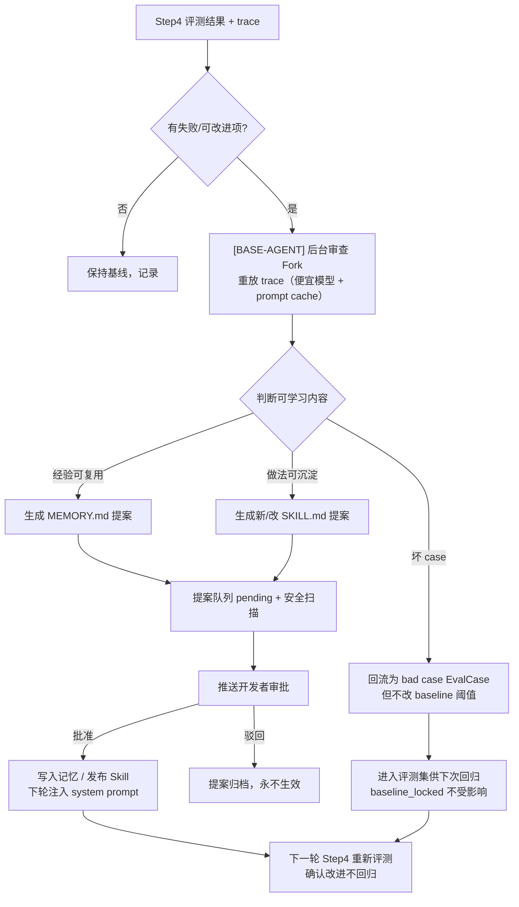

# 02 — Eval-driven 开发流程设计

> 版本：v0.2（设计稿）
> 撰写日期：2026-09-18
> 修订日期：2026-09-18（v0.2：观测字段诚实声明；自进化改为 [BASE-AGENT] 原生表述；详见文末「修订记录」）
> 上游：`01-architecture.md`
> 核心理念：**先定验收，再写架构，最后用真实观测验证**；验收基线独立、可验证、不被自进化偷偷改写。

---

## 0. 四步流程总览

```
Step1 业务目标 ──► Step2 验收标准 ──► Step3 架构设计 ──► Step4 测试验证
(grill / prompt)   (独立可验证产物)   (组件选择+Skill)    (观测 trace 取数)
      ▲                                                    │
      └────────────  自进化闭环（提案→人工审批→生效）◄──────┘
```

| 步骤 | [DELIVERY] 行为 | 用户交互 | 关键产物 | 验收门槛 |
|---|---|---|---|---|
| 1 确定业务目标 | 深度访谈 or 快速生成 | 回答问题 / 给一句话目标 | 目标定义卡 | 目标可被一句成功标准复述 |
| 2 验收标准 | 把目标翻译成「可独立验证的结果」 | 确认/修改评测点 | 验收标准模板 + 评测集种子 | 每条验收都有「如何判断通过」 |
| 3 架构设计 | 调用组件 Skill，生成拓扑 | 决策树选择 | 设计时拓扑 + harness 配置草案 | 每个组件都有选用/不选用理由 |
| 4 测试验证 | 触发测试，**从观测取数** | 看真实 trace，判断通过/失败 | 运行时 trace 报告 + 评测结果 | 与 Step2 验收逐项对照，不编数 |

> 贯穿铁律（证据 `doc01.md` Sidecar「Final Response Verifier：无证据完成声明被阻断」；`doc07.md`「检查实际结果而非 Agent 完成声明」）：
> **[DELIVERY] 不得仅凭目标 Agent 说「我完成了」就判通过，必须核对独立产物 / 外部状态 / trace 证据。**

---

## Step 1：确定业务目标

### 1.1 两条入口路径

[DELIVERY] 提供两种入门方式，按用户输入自动分流：

| 路径 | 触发 | 做法 | 证据 |
|---|---|---|---|
| **深度访谈（grill-with-docs）** | 用户说不清楚、或涉及复杂业务 | [DELIVERY] 用 `grill-with-docs` skill 逐题深挖：目标用户、任务、输入输出、成功标准、边界、坏 case | `doc08.md` §7「定义场景：目标用户、业务任务、输入输出、成功标准」 |
| **Prompt 快速生成** | 用户给一句话目标 | [DELIVERY] 直接生成一版「目标定义卡」草稿，让用户改，跳过逐题访谈 | `doc01.md` Studio「自然语言/配置搭建」；`03-quickstart.md` |

### 1.2 输入 / 输出

- **输入**：用户自然语言（一句话或零散需求）。
- **[DELIVERY] 行为**：
  - 识别是否「存量迁移」（已有 LangChain/ADK/Dify）→ 直接转 `doc01.md` 迁移路径。
  - 识别是否「长链路任务」（跨系统排障/日志分析/代码迁移）→ 标记后续要接 Sidecar 治理四件套。
- **输出：目标定义卡（Goal Card）**

```yaml
goal_card:
  场景名称: <目标用户是谁>
  业务任务: <Agent 要替用户完成什么>
  典型输入: <用户会怎么提问>
  期望产出: <什么样算完成>
  非目标: <明确不做什么，防止 scope 蔓延>
  长链路任务: <是/否，是否需要 Sidecar>
  是否存量迁移: <否 / framework>
```

### 1.3 验收（Step1 出口）

- 目标可被**一句成功标准**复述，且用户确认。
- [DELIVERY] 能从卡片回答出「这个任务更像 RAG 问答 / 工具调用 / 代码执行 / 多 Agent 协作」中的哪一类（`01-overview.md` §3 应用场景）。

---

## Step 2：确定验收标准与评测判断方式

### 2.1 核心原则：独立、可验证、不被进化改写

> 约束落地：**评测需以独立、可验证产物/外部状态为依据；验收基线不得由进化过程偷偷改写。**

三种可验证依据（按优先级）：

1. **独立产物**：Agent 生成的文件/代码/表格，可被确定性检查（如「测试 8 passed」「文件存在且字段正确」——证据 `doc01.md` Sandbox 产物 `test_currency.py 8 passed`）。
2. **外部系统状态**：调用下游后真实状态变化（如订单已创建、工单已流转），而非 Agent 自述。
3. **LLM-as-Judge / 官方评估器**：前两者无法覆盖的语义质量，用平台内置评估器（内容质量/工具调用/轨迹质量，`doc07.md`）+ 人工校准。

> 反向铁律：**不接受**「Agent 回复中自称完成」「状态=done」这类无外部证据的声明当验收（`doc01.md` Final Response Verifier 阻断 `completion claim has no successful capability receipt`）。

### 2.2 验收标准模板（[DELIVERY] 引导用户填）

```yaml
acceptance:
  eval_id: <唯一 id，进入评测集，锁定不可被自进化改写>
  description: <这条验收测什么>
  输入样例: <user prompt + 可选 files>
  判断方式:
    type: artifact | external_state | llm_judge | rule
    具体:
      # artifact: 检查哪个产物的哪个字段/测试
      # external_state: 调哪个下游接口断言什么状态
      # llm_judge: 用哪个评估器，judge prompt 是什么
      # rule: 确定性规则（HTTP 200 / 字段非空 / 无敏感词）
  通过阈值: <如 accuracy≥0.8，或 8/8 测试通过>
  基线锁定: true   # 自进化提案不得修改本条
```

### 2.3 评测判断方式的四层验收（借自身份/网关实测经验）

对涉及工具调用的验收，[DELIVERY] 强制要求**四层分别断言**，不允许「握手成功=通过」（证据 `doc06.md` Q4「四层验收分别断言：①initialize ②tools/list 可见 ③tools/call isError ④后端真实执行」）：

1. 接入层：HTTP 状态码 / 连接是否建立。
2. 工具可见层：`tools/list` 是否能看到目标工具。
3. 调用层：`tools/call` 是否 `isError=false`。
4. 真实效果层：下游是否真产生了预期产物/状态。

> 例：目标 Agent 调知识库问答，不能只验「返回了字符串」，要验「答案引用了目标切片」（用 `10-knowledge-base.md` 查看切片详情能力核对）。

### 2.4 评测集种子生成

- [DELIVERY] 依据 Goal Card 生成 5–10 条种子 EvalCase（good/bad case 混合）。
- 线上运行后由**观测 trace 自动回流**扩充评测集（证据 `doc07.md`「线上 trace 实时智能回流评测集」；`doc01.md` Studio 赞/踩 → EvalCase）。
- **基线 EvalCase 冻结**：进入 Step2 的 EvalCase 标记 `baseline_locked=true`，自进化流程无权改写（见 `04-[BASE-AGENT]-self-evolution.md` §4）。

### 2.5 验收（Step2 出口）

- 每条验收都有明确「如何判断通过」，且至少有一条 artifact 或 external_state 类硬验收（不能全是 LLM 主观打分）。
- 评测集种子已写入平台评测集，`baseline_locked=true`。

---

## Step 3：架构设计（组件选择引导 + Skill 调用）

### 3.1 引导逻辑：每个组件都要回答「为什么选 / 为什么不选」

[DELIVERY] 不是罗列组件，而是按 Step1/2 的目标与验收，用决策逻辑逐个判定。完整矩阵见 `03-component-mapping.md`。核心引导规则：

| 信号 | 推荐选用 | 证据 |
|---|---|---|
| 目标是文档问答 | 知识库 VikingDB RAG | `10-knowledge-base.md` |
| 要调企业存量 API | Gateway/MCP（OpenAPI 转 MCP） | `doc04.md`；`11-gateway.md` |
| 多 Agent 互相调用 | A2A Registry | `doc04.md` A2A 网关；`08-a2a.md` |
| 要跑代码/不可信逻辑 | Sandbox（按场景选 AIO/Code/Skills） | `06-sandbox.md`；`doc02.md` 沙箱矩阵 |
| 要跨会话记忆 | 会话资源 + 长期记忆库（mem0/viking_mem） | `09-session-memory.md` |
| 上线给真人用户 | 身份权限 + 安全围栏 | `12-identity-permission.md`；`13-guardrails.md` |
| 长链路易漂移 | Harness Sidecar 四件套 | `doc01.md` |
| 生产 vs POC | 专属网关 vs 共享模式 | `05-runtime.md` |

### 3.2 Skill 调用机制

[DELIVERY] 把每个 [PRODUCT] 组件抽象为一个 Skill（`skills/` 目录）。Step3 按组件按需加载，复用「描述决定是否加载」的渐进式披露（证据 `doc01.md` Skill 三种挂载；`01-[BASE-AGENT]-agent.md` 技能渐进式披露不占固定 token）。

- 已完成 Skill（v1.0.0，共 14 个）：`[PRODUCT]-runtime`、`[PRODUCT]-sdk`、`[BASE-ADK]`、`adk-workflow`、`[PRODUCT]-knowledge-base`、`[PRODUCT]-a2a-registry`、`[PRODUCT]-skills`、`[PRODUCT]-gateway-mcp`、`[PRODUCT]-identity-permission`、`[PRODUCT]-guardrails`、`[PRODUCT]-evaluation`、`[PRODUCT]-observability`、`[PRODUCT]-sandbox`、`[PRODUCT]-session-memory`。
- 每个 Skill 按 `SKILL-TEMPLATE.md` 结构：概述 / 前置条件 / 快速上手 / 输入输出 / 权限安全 / 失败处理 / **可执行验证办法** / 组件关系 / 限制 / 来源追溯。

> [DELIVERY] 调用 Skill 的方式：先读 Skill 的「前置条件」，不满足就先引导补齐；再按「可执行验证办法」生成 Step4 的验证用例。

### 3.3 设计时拓扑产出

Step3 输出**设计时拓扑图**（组件连接的计划态，见 `01-architecture.md` §6），并附每个组件：
- 选用理由 / 不选用理由；
- 前置依赖是否满足；
- 对应 Skill 路径；
- 部署形态（Runtime / MCP / Sandbox / 关联组件）。

### 3.4 验收（Step3 出口）

- 每个组件的选/弃都有一句话理由。
- harness 配置草案（`harness.yaml` / `[PRODUCT].yaml`）已生成，但**尚未部署**。

---

## Step 4：测试验证 + 观测 trace 取数

### 4.1 流程

```
1. [DELIVERY] 在隔离 Sandbox / 测试 Runtime 触发 Step2 评测集
2. 每次调用从 APMPlus trace + TLS 日志 取数（不凭 Agent 自述）
3. 渲染「设计态 vs 运行态」对照：
   - 设计态=已连接，但运行态无 trace → 标「无数据」（≠未调用）
   - 观测未开启 → 标「未知」，先引导开启观测
4. 与 Step2 验收逐项对照，出通过/失败报告
```

### 4.2 观测取数方案（数据源诚实，单次 trace 与聚合观测严格分离）

> **⚠️ 核心修正（v0.4，2026-09-18）**：此前版本把集群聚合 Metrics（Histogram P50/P95、Counter 调用次数）误用于单次 trace 节点/边数据。本节已重写，严格分离：
> - **单次 trace 数据**（一次 run_id/trace_id 范围内）：仅用该 trace 内的真实 span 数据——duration 由 span `start_time`→`end_time` 差值计算（APMPlus GetTraceDetail 返回 `DurationMicroseconds`），不是 Histogram P50/P95；错误来自 span `Status=ERROR` 或 `ErrorInfoList`，不是 error_type 维度聚合计数；调用次数按操作语义计数（span 出现次数），不是 Counter。
> - **聚合观测数据**（选定时间窗）：P50/P95/QPS 等是 Histogram/Counter 在时间窗内的聚合统计，**独立展示在「近 N 小时聚合」面板中，不归属到任何一次调用**。
> - APMPlus trace 查询 API 已通过火山引擎 API Explorer 核验：GetTraceDetail（按 TraceId 查 span 树）、ListSpan（按时间范围+过滤条件）、ListSession（会话级 token 统计）。

证据：`shard4-results.md` 观测相关页 + 附录 A/B；`doc07.md`「trace attribute Follow gen.ai 标准、一键导出任务」；火山引擎 API Explorer GetTraceDetail/ListSpan/ListSession 核验（2026-09-18）。

> **字段说明（v0.4 更新，2026-09-18）**：
> - **日志字段 10 个**：`attribute / file_line / file_name / hostname / log_level / message / resource / service / source / trace_id`（来源 `shard4-results.md` 附录 A，[PRODUCT] 专用日志存于 `apmplus-server` 项目下 `apmplus-server-log` 主题）。
> - **埋点字段已通过浏览器 DOM 补读成功**（来源 `browser-gap-results.md` 任务1）：[PRODUCT] 侧 9 个 `gen_ai.*` Span 属性 + 2 个 Metrics（Histogram/Counter，维度 `error_type`/`operation_name`/`operation_type`）；[BASE-ADK] 侧 4 个 Span 名（`invocation`/`invoke_agent {name}`/`call_llm`/`execute_tool {name}`）+ 通用类 15 + LLM 类 23 + Tool 类 9 字段。
> - **APMPlus 查询 API 已核验**：GetTraceDetail（按 TraceId 查 span 树，返回 `SpanList[]` 含 `DurationMicroseconds`/`Status`/`ErrorInfoList`/`ParentSpanId`/`OperationName`/`ServiceName` 等）、ListSpan（按时间范围+过滤条件）、ListSession（会话级 token 统计）。域名 `apmplus-server.cn-beijing.volcengineapi.com`，鉴权 AK/SK HMAC-SHA256 签名 V4，API Version `2026-01-01`，`BusinessCarrier=[PRODUCT]_runtime`。
> - **单次 trace 的 duration 计算**：由 span 的 `DurationMicroseconds / 1000` 得出（span 起止差），**不是 Metrics Histogram 的 P50/P95**。
> - **单次 trace 的错误判定**：来自 span `Status=ERROR` 或 `ErrorInfoList` 非空，**不是 error_type 维度的跨调用聚合计数**。
> - **单次 trace 的调用次数**：按操作语义计数——同一 `execute_tool {tool.name}` span 出现 N 次 = 该工具被调用 N 次（含重试），**不是 `_count` Counter**。
> - **P50/P95/QPS**：这些是选定时间窗的聚合观测指标，**独立展示在「近 N 小时聚合」面板中，绝不归属到任何一次调用**。
> - **内容采集开关**：`observability.opentelemetry.trace_content` 或 `OBSERVABILITY_OPENTELEMETRY_TRACE_CONTENT=false` 时，`gen_ai.input`/`output`/`prompt`/`completion` 等内容字段不写入 Span；普通链路、模型参数、Token 用量、工具名等仍保留。
> - **数据回流上限**：线上 Trace 批量导出至评测集，**每任务上限 100000 条**，且仅支持回流新数据、不支持历史数据（`shard4-results.md` 数据回流页，附录 F）。

#### 4.2.1 单次 trace 取数表（Step4 测试验证核心路径）

| 要回答的问题 | 从哪取数（单次 trace） | 取什么（单次 trace span 数据） |
|---|---|---|
| 目标 Agent 是否被调用 | APMPlus GetTraceDetail 查 TraceId 对应的 span 树 | trace 中有 `invoke_agent {agent.name}` span → 已调用；无 → 无数据（≠未调用） |
| 哪个 Skill 被执行 | 单次 trace 内 span 树遍历 | trace 中有 `execute_tool {tool.name}` span → 该 Skill 被执行；span 出现 N 次 = 被调用 N 次（含重试） |
| 知识库是否真检索 | 单次 trace 内 span 属性 | span 属性中 KB 检索相关字段（待 POC 确认具体字段名） |
| MCP 工具集是否被调用 | 单次 trace 内 `call_service_type`+`call_service_name` span | APMPlus 返回的 `CallServiceName`/`CallResourceName` → 对应 MCP 服务/工具 |
| 模型消耗 | 单次 trace 内 `call_llm` span | `gen_ai.usage.input_tokens`/`output_tokens`/`total_tokens`/`cache_*_tokens`、`gen_ai.request.model` |
| 单次调用耗时 | 单个 span 的 `DurationMicroseconds / 1000` | span 起止差计算，**不是 Histogram P50/P95** |
| 单次调用是否失败 | span `Status` + `ErrorInfoList` | `Status=ERROR` 或 `ErrorInfoList` 非空 → 失败标红 |
| 失败根因 | trace 下钻 + TLS 日志 | span 树、错误栈（`ErrorInfoList.ErrorStack`）、攻击日志（安全围栏）；日志下钻用已核验 10 字段 |

#### 4.2.2 聚合观测面板取数表（独立面板，不归属单次调用）

| 要回答的问题 | 从哪取数（聚合面板） | 取什么（时间窗聚合统计） |
|---|---|---|
| 目标 Agent 近期 QPS/错误率趋势 | APMPlus ListSpan（时间窗+BusinessCarrier=[PRODUCT]_runtime）+ [PRODUCT] Metrics | `[PRODUCT]_runtime_operation_latency_count` Counter 聚合（QPS/总调用次数） |
| 目标 Agent 近期 P50/P95 时延 | 同上 | `[PRODUCT]_runtime_operation_latency` Histogram 聚合（P50/P95） |
| MCP 服务近期请求量/错误码 | 同上 + MCP 监控 | 请求次数 / 错误码分布 / 平均时延（时间窗聚合） |
| 模型服务近期 Token 消耗趋势 | 同上 + 模型服务监控 | Token / 推理时延 / 缓存效率（时间窗聚合） |

> **⚠️ 铁律重申**：
> 1. **单次 trace 只用 span 数据**（起止差 duration / span 状态错误 / 操作语义计数），**不用聚合 Metrics**。
> 2. **P50/P95/QPS 是聚合指标**，独立展示在「近 N 小时聚合」面板中，**不归属到任何一次调用**。
> 3. **trace 里没有某组件的 span，只能写「观测期内未观测到该组件调用」，不能写「该组件未使用」**。若观测本身未开启（在线评测必须开启观测），第一步先引导开启，再取数。
> 4. **组件调用证据映射**：用 `service.name`+`operation.name`+`gen_ai.agent.name`/`gen_ai.tool.name`+资源 ID 做映射，碰撞标 `unknown`；trace 中发现但设计图中没有的节点标 `observed-unmapped`。

### 4.3 不编造的兜底

- 若 APMPlus/TLS 暂不可用（待核验项 `01-architecture.md` §8 #3），[DELIVERY] 在报告中写 `运行态=未知/无数据`，并列出「开启观测的操作步骤」，**不渲染任何假的调用数字**。
- 报告每个数字都附「来源：APMPlus trace / TLS 日志 / 本地测试」，可回溯。

### 4.4 验收（Step4 出口）

- Step2 的每条验收都有「通过/失败」结论 + 证据来源。
- 运行态拓扑图与设计态拓扑图并排展示，差异处高亮。
- 失败项进入自进化闭环（§5）。

---

## 5. 自进化闭环（评测结果 → [BASE-AGENT] 后台审查 → 提案 → 人工审批 → 生效）



### 闭环纪律（关键）

1. **只学「怎么做得更好」，不学「怎么把标准改松」**：坏 case 回流只**扩充**评测集，绝不修改 `baseline_locked` 的通过阈值（证据：`01-architecture.md` §4.3 约束；`doc07.md` 评测门禁是准出把关）。
2. **提案默认不生效**：任何 MEMORY.md / SKILL.md 改动进 pending，人工批准后才写入（`01-[BASE-AGENT]-agent.md` §3.2/§3.3 write_approval）。
3. **改完必须回归**：提案生效后，下一轮 Step4 重跑评测集，确认「改进项变好 + 原有项不回归」，才算闭环完成。
4. **安全扫描前置**：写记忆/技能前检测 prompt injection、凭证泄露、后门模式（`01-[BASE-AGENT]-agent.md` §3.2）。

---

## 6. 四步流程与 Skill / 文档对照表

| 步骤 | 主要调用 Skill | 产出文档 |
|---|---|---|
| Step1 | `grill-with-docs`（经 [DELIVERY] 适配层调度：[BASE-AGENT] 无「Skill tool」，依次注入 grilling+domain-modeling 子 skill 提示词流程，详见 §7） | Goal Card |
| Step2 | `[PRODUCT]-evaluation`（设计完成 v1.0.0） | 验收标准模板 + 评测集种子 |
| Step3 | 全部 14 组件 Skill（见 `03-component-mapping.md`） | 设计时拓扑 + harness 草案 |
| Step4 | `[PRODUCT]-observability`（设计完成 v1.0.0）、`[PRODUCT]-evaluation` | 运行时 trace 报告 + 评测结论 |
| 闭环 | [BASE-AGENT] 原生自进化（运行在 [BASE-AGENT] 底座进程内，非 sidecar；见 `04-[BASE-AGENT]-self-evolution.md`） | 改进提案 / 回归结果 |

---

## 7. 待核验 / 需额外开发项

| 项 | 说明 |
|---|---|
| `grill-with-docs` skill | **已读取全文确认**（2026-09-18）：`grill-with-docs` 入口 + `grilling`（design tree 分轮访谈）+ `domain-modeling`（实时维护 CONTEXT.md + ADR）三个子 skill 均为纯 prompt/流程型，无代码依赖。`grill-with-docs` 的 `disable-model-invocation: true` 须显式调用；`grilling`/`domain-modeling` 可按描述触发。**兼容调度设计（[BASE-AGENT] 适配层，非原样运行）**：`grill-with-docs/SKILL.md` 原文要求「Call the Skill tool twice, for grilling and domain-modeling」——这是 Claude 等宿主的 Skill 工具调用指令，**[BASE-AGENT] 原生没有「Skill tool」**。[BASE-AGENT] 通过 `~/.[BASE-AGENT]/skills/` 机制把各 SKILL.md 作为系统提示加载；「调用 Skill 工具两次」在 [BASE-AGENT] 中**不能原样执行**，必须由 [DELIVERY] 引导编排层（适配层）翻译为：在对话循环内依次把 `grilling/SKILL.md`、`domain-modeling/SKILL.md` 两份提示词内容注入为子流程（先 grilling 分轮访谈，再 domain-modeling 实时维护 CONTEXT.md/ADR）。子 skill 路径已确认存在：`~/.agents/skills/grilling/SKILL.md`、`~/.agents/skills/domain-modeling/SKILL.md`。适配层还需补齐 grilling 的 dispatch sub-agent 找事实能力。**结论：三个 SKILL.md 可放入 [BASE-AGENT] skills 目录作为提示素材，但「调用 Skill 工具两次」必须经 [DELIVERY] 适配层翻译，不能声明原样加载即可运行。** |
| ~~观测埋点字段详情~~ → ✅ 已补读 | ~~未获取~~ → 已通过浏览器 DOM 补读成功（2026-09-18，`browser-gap-results.md` 任务1）：[PRODUCT] 9 Span 属性+2 Metrics、[BASE-ADK] 4 Span 名+15 通用+23 LLM+9 Tool 字段。Step4 取数字段契约已可用；仍需在真实 Runtime 上验证 trace 数据实际导出（云联调前提） |
| 评测集回流对接 | Studio 仅「线上 Agent 会话」支持赞/踩回流（`doc01.md`），本地 Agent 会话不回流——[DELIVERY] 需明确回流走线上 Runtime；**线上 Trace 批量导出至评测集每任务上限 100000 条、仅回流新数据**（`shard4-results.md` 数据回流页） |
| 轨迹白盒化评测 | 规划 9 月补齐（`doc07.md`），当前以结果评测为主，过程评测能力**待核验** |
| 自进化运行在 [BASE-AGENT] 底座进程内 | 自进化是 [BASE-AGENT] 原生能力（`05-...verification.md` §1c），非 sidecar；与 [PRODUCT] 评测/观测的联动（读 trace、读评测结果、写提案）需在薄 shim 内打通，**待 POC** |

---

## 修订记录

### v0.4（2026-09-18）— 单次 trace 与聚合观测严格分离 + APMPlus 查询 API 核验

1. **§4.2 整节重写**：严格分离单次 trace 与聚合观测——单次 trace 的 duration 由 span `DurationMicroseconds/1000`（起止差）得出，**不再使用 Histogram P50/P95**；错误来自 span `Status`/`ErrorInfoList`，**不再使用 error_type 维度聚合计数**；调用次数按操作语义计数（span 出现次数），**不再使用 `_count` Counter**；P50/P95/QPS 等聚合指标独立为「聚合观测面板」（§4.2.2），**绝不归属到任何一次调用**。
2. **APMPlus 查询 API 已核验**：GetTraceDetail（按 TraceId 查 span 树）、ListSpan（按时间范围+过滤条件）、ListSession（会话级 token 统计）。域名 `apmplus-server.cn-beijing.volcengineapi.com`，鉴权 AK/SK HMAC-SHA256 签名 V4，API Version `2026-01-01`，`BusinessCarrier=[PRODUCT]_runtime`。
3. **§4.2 取数表拆分为两张**：§4.2.1 单次 trace 取数表（Step4 测试验证核心路径）+ §4.2.2 聚合观测面板取数表（独立面板）。
4. **组件调用证据映射**：用 `service.name`+`operation.name`+`gen_ai.agent.name`/`gen_ai.tool.name`+资源 ID 做映射，碰撞标 `unknown`；trace 中发现但设计图中没有的节点标 `observed-unmapped`。
5. **保留正确部分**：日志 10 字段、trace 缺失≠未调用、数据回流 100000 条/任务上限、baseline_locked 不被进化改写、人工批准生效、不编造兜底——均保留。

### v0.3（2026-09-18）— 浏览器 DOM 补读成功后更新观测字段契约

1. **观测字段从"未获取"升级为真实字段摘要**：§4.2 字段声明从"埋点字段详情未获取、不可当开发契约"更新为"已通过浏览器 DOM 补读成功"——[PRODUCT] 9 个 `gen_ai.*` Span 属性 + 2 个 Metrics（latency/count，维度 error_type/operation_name/operation_type）；[BASE-ADK] 4 个 Span 名 + 通用类 15 + LLM 类 23（含 `gen_ai.usage.*` token 五项）+ Tool 类 9 字段。trace 回流的元数据字段现可基于真实 span 字段定义。
2. **新增内容采集开关说明**：`trace_content=false` 时内容字段不写入 Span，但普通链路/模型参数/Token 用量/工具名仍保留——Step4 取数需处理此降级。
3. **§7 待核验项更新**：观测埋点字段从"未获取"移到"已补读"，保留"实际导出待云联调"的诚实声明。
4. **保留正确部分**：日志 10 字段、trace 缺失≠未调用、数据回流 100000 条/任务上限、baseline_locked 不被进化改写、人工批准生效、不编造兜底——均保留。

### v0.2（2026-09-18）

1. **观测字段诚实声明**：新增「已核验日志字段仅 10 个」「埋点字段详情未获取、不可当开发契约」「数据回流每任务上限 100000 条、仅新数据」三条，纠正旧版把观测字段当既定契约的表述；§4.2 取数表补充采集频率/查询范围与 MCP 工具集语义/标签检索指标。
2. **自进化表述纠偏**：闭环与对照表中「[BASE-AGENT] sidecar」改为「[BASE-AGENT] 原生自进化（运行在 [BASE-AGENT] 底座进程内，非 sidecar）」，与 `01-architecture.md` v0.2 底座修正一致。
3. **保留正确部分**：四步流程框架、设计时拓扑 vs 运行时 trace 区分、trace 缺失≠未调用、`baseline_locked` 不被进化改写、人工批准生效、不编造兜底——均保留。
