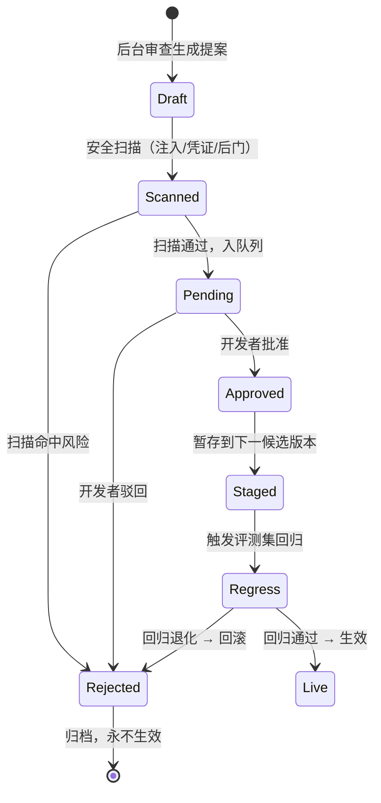

# 04 — [BASE-AGENT] 自进化设计（原生机制使用 / 提案-审批 / 安全边界）

> 版本：v0.2（设计稿）
> 撰写日期：2026-09-18
> 修订日期：2026-09-18（v0.2：从「移植方案」重写为「原生机制使用」；删除无依据行数估算；详见文末「修订记录」）
> 上游：`01-architecture.md` §4；`02-eval-driven-flow.md` §5
> 核心定性：[BASE-AGENT] 自进化是 **[BASE-AGENT] 原生能力**（后台审查 Fork + 自主记忆管理 + 自主技能创建），**不是模型权重更新，也不需要移植到 [BASE-ADK]**。自进化边界 = 自动学习并提出改进提案，**人工批准后才生效**。

---

## 1. 定性纠偏：为什么是「用原生」而不是「移植」

### 1.1 旧版错误（v0.1）

旧版把 [BASE-AGENT] 自进化当成「需要从 [BASE-AGENT] 抽出来、移植到 [BASE-ADK] 的新代码」，并估算「约 2000–3000 行」。这基于一个错误前提：[DELIVERY] 底座是 [BASE-ADK]，[BASE-AGENT] 只是 sidecar。

### 1.2 新版结论（v0.2，证据 `05-[BASE-AGENT]-as-base-verification.md`）

- **[DELIVERY] 底座 = [BASE-AGENT] 原生主循环**（`run_agent.AIAgent` + `agent/conversation_loop.run_conversation`）。自进化本来就跑在这个进程里，**不存在「移植」**。
- [BASE-AGENT] 自带常驻 gateway 进程（`gateway/run.py` 的 `start_gateway()`/`GatewayRunner`，含 agent cache、reconnect watcher、compaction 后台任务、cron），后台审查 Fork 与记忆 curation 是其原生运行时能力。证据：`05-...verification.md` §1c/§1d。
- **不给出无依据的行数估算**。旧版「2000–3000 行」「`[BASE-AGENT]HarnessExtension` 约 200 行」均无代码级依据，删除；[DELIVERY] 侧真正要开发的是**与 [PRODUCT] 评测/观测的联动适配**（见 §4），不是重写自进化本身。

### 1.3 自进化是什么 / 不是什么

| | 说明 |
|---|---|
| **是** | 提示词工程层面的运行时学习：后台审查重放 trace → 写 MEMORY.md / 建 SKILL.md → 注入下轮 system prompt |
| **不是** | 不改模型权重；不改 Runtime 拓扑；不改身份/安全配置；不直接生效（必须人工批准） |

证据：`01-[BASE-AGENT]-agent.md` §3.6；`05-...verification.md` §1c。

---

## 2. [BASE-AGENT] 原生自进化机制（在 [DELIVERY] 中如何使用）

> 以下三项是 [BASE-AGENT] 原生能力。[DELIVERY] 不重写它们，只在其上叠加「与 [PRODUCT] 评测/观测联动」和「强制提案-审批」两层。

### 2.1 后台审查 Fork

- **原生行为**：一轮对话结束后，[BASE-AGENT] 可异步起一个审查 Fork 重放该轮 trace（可用更便宜模型 + prompt cache 降本），判断「有什么值得记住/沉淀/纠正」。
- **[DELIVERY] 用法**：审查 Fork 读取的 trace 来自 [PRODUCT] 观测（APMPlus trace + TLS 日志，见 §4），而非仅本地 `state.db`；审查输出只**生成提案**，不直接写。
- **证据**：`01-[BASE-AGENT]-agent.md` §3.1；`05-...verification.md` §1c（gateway 常驻进程 + compaction 后台任务）。

### 2.2 记忆 curation（MEMORY.md / USER.md）

- **原生行为**：[BASE-AGENT] 有 memory 工具（add/replace/remove），把经验写进 `~/.[BASE-AGENT]/` 下的 MEMORY.md / USER.md，下轮注入 system prompt；`memory.write_approval=true` 时写入进暂存队列，`/memory pending` → `approve/reject`。
- **原生硬约束**：MEMORY.md 约 2200 字符（~800 tokens）、USER.md 约 1375 字符（~500 tokens），超限工具报错需合并重试；写入前检测 prompt injection / 凭证泄露 / SSH 后门。证据：`01-[BASE-AGENT]-agent.md` §3.2。
- **[DELIVERY] 用法**：强制 `write_approval=true`；记忆提案必须经人工批准（见 §3）；多实例 Runtime 下 `~/.[BASE-AGENT]/` 本地文件不共享，是否要把记忆映射到平台外部记忆后端（mem0/viking）属**待核验桥接项**（见 §5）。

### 2.3 技能自主创建 / 改进（SKILL.md）

- **原生行为**：[BASE-AGENT] 可生成新 SKILL.md 或 patch 现有 SKILL.md，`skills.write_approval` 控制写入；技能渐进式披露加载，不占固定 token。
- **[DELIVERY] 用法**：技能提案必须经人工批准 diff；新 Skill 发布后下轮会话才可被渐进式加载。
- **证据**：`01-[BASE-AGENT]-agent.md` §3.3。

---

## 3. 提案-审批流程设计

### 3.1 三类提案，三档审批强度

| 提案类型 | 例子 | 审批强度 | 证据 |
|---|---|---|---|
| 记忆提案（MEMORY.md/USER.md） | 「该用户偏好中文回复」 | 需人工批准（`memory.write_approval`） | `01-[BASE-AGENT]-agent.md` §3.2 |
| 技能提案（新建/改 SKILL.md） | 「沉淀排障 SOP 为新 skill」 | 需人工批准 diff（`skills.write_approval`） | `01-[BASE-AGENT]-agent.md` §3.3 |
| 评测回流（bad case 进评测集） | 「这次答偏了，加入回归集」 | **不审批也允许**（只扩充数据集，不改阈值） | `02-eval-driven-flow.md` §5 |

### 3.2 审批流状态机



### 3.3 审批交互

- [DELIVERY] 在对话中向开发者展示：**提案 diff（改了哪几行）+ 理由 + 预期影响**。
- 开发者 `批准 / 驳回 / 要求修改`。
- 批准后不直接上线，先 `Staged` 跑一轮 `02-eval-driven-flow.md` Step4 回归，确认「改进项变好 + 旧项不回归」才 `Live`。

---

## 4. 与 [PRODUCT] 评测 / 观测的联动

### 4.1 数据流向

```
观测（APMPlus trace + TLS 日志）
   │ 数据回流（线上 Trace 批量导出至评测集，每任务上限 100000 条、仅新数据）
   ▼
评测集（扩充 good/bad case；baseline_locked 不动）
   │ 评测失败/可改进项
   ▼
[BASE-AGENT] 原生后台审查 Fork（读取 trace 重放）
   │
   ▼
生成改进提案 → 审批 → 生效 → 下一轮重新评测
```

证据：`shard4-results.md` 数据回流页（附录 F，每任务 100000 条上限）；`15-evaluation.md` 三件套。

### 4.2 联动纪律

1. **评测是自进化的「眼睛」，但不是「笔」**：自进化只能读 trace、读评测结果来学习；**不能**反向改评测基线阈值。
2. **每次提案生效后必须回归**：用平台评测实验做 A/B（新提案 vs 旧版本），对比效果变化趋势（`15-evaluation.md`）。
3. **观测字段诚实**：已核验的日志字段仅 10 个（attribute/file_line/file_name/hostname/log_level/message/resource/service/source/trace_id，`shard4-results.md` 附录 A）；埋点字段详情在外部 APMPlus 文档站，**未获取，不可当开发契约**。审查 Fork 读取 trace 时只依赖已核验字段与大盘指标，未获取字段不得编造。
4. **轨迹白盒化评测**：若 9 月已补齐（`doc07.md`），则自进化可分析「过程」；在此之前只做结果评测。**当前能力待核验。**

---

## 5. 安全边界（什么不能自动改）

> 这是自进化的「红线」。以下项 [BASE-AGENT]/[DELIVERY] **只能提案、不能自动生效**，且部分项**根本不允许**自进化碰。

| 类别 | 能不能自改 | 原因 / 证据 |
|---|---|---|
| **评测基线阈值**（`baseline_locked` EvalCase 的通过线） | ❌ 绝不能自动改 | 约束：验收基线不得被进化偷偷改写；改松=自欺 |
| **安全围栏策略 / Cedar 权限策略** | ❌ 不能自动改 | `doc06.md` 权限是生产前提，改权限=改安全边界 |
| **出站凭据 / API Key / OAuth Secret** | ❌ 绝不能写进记忆或日志 | `doc06.md` 严禁日志/Trace/错误体回显 token；[BASE-AGENT] 写入前需凭证泄露扫描 |
| **身份配置（UserPool/Client/SSO）** | ❌ 不能自动改 | 身份链是安全核心 |
| **MEMORY.md / USER.md 内容** | ⚠️ 可提案，人工批准后写 | `01-[BASE-AGENT]-agent.md` §3.2 write_approval |
| **SKILL.md 新建/改进** | ⚠️ 可提案，人工批准 diff | `01-[BASE-AGENT]-agent.md` §3.3 skills.write_approval |
| **业务 SOP / 排障经验** | ⚠️ 可提案沉淀为 Skill | `doc08.md` 六步 Skill 资产化（业务审核+badcase评测+版本diff审批） |
| **prompt injection / 凭证泄露 / 后门模式** | ❌ 写入前强制安全扫描拦截 | `01-[BASE-AGENT]-agent.md` §3.2 安全扫描 |

### 5.1 记忆写入的硬约束（证据 `01-[BASE-AGENT]-agent.md` §3.2）

- `MEMORY.md` 约 2200 字符（~800 tokens），`USER.md` 约 1375 字符（~500 tokens）——超限工具报错，需合并后重试。
- 写入前检测 prompt injection / 凭证泄露 / SSH 后门。
- `memory.write_approval=true` 时写入进暂存队列，`/memory pending` → `approve/reject`。

### 5.2 进化不能突破的架构边界

- 自进化**只改 prompt 层资产**（记忆/技能文本），**不改模型权重**、不改 Runtime 拓扑结构、不改身份/安全配置。
- 若改进提案需要新组件（如新加 MCP 工具），走 `02-eval-driven-flow.md` Step3 重新设计，**不走自进化快通道**。

---

## 6. 待核验 / 需额外开发项

| 项 | 状态 | 说明 |
|---|---|---|
| [BASE-AGENT] 原生后台审查 Fork 读取 [PRODUCT] trace 的通道 | 需打通 | 审查 Fork 读的是 APMPlus trace/TLS 日志，非仅本地 `state.db`；薄 shim 内需打通，**待 POC** |
| 多实例 Runtime 下 `~/.[BASE-AGENT]/` 本地记忆/文件不共享 | 待核验 | 是否把记忆映射到平台外部记忆后端（mem0/viking）需桥接开发 |
| 便宜模型 + prompt cache 重放的成本/质量 | 需 POC | `01-[BASE-AGENT]-agent.md` §3.1 |
| 审批 UI/飞书通知通道 | 需开发 | 当前无现成审批界面 |
| 观测埋点字段详情 | 未获取 | 在外部 APMPlus 文档站，不可当契约（`shard4-results.md` 附录 B） |
| Studio BFF 侧 [BASE-AGENT] session 管理 | 闭源平台侧 | 不在本仓库范围（`02-[BASE-ADK]-verification.md` 声明 c） |

---

## 7. 一句话总结

[DELIVERY] 直接使用 **[BASE-AGENT] 原生自进化**（后台审查 Fork → 学习 → 提案 → 人工批准 → 回归验证），不重写、不移植；在其上叠加「与 [PRODUCT] 评测/观测联动」和「强制提案-审批」两层。**学习自动、生效人工、基线不动、安全红线不可碰**。当前全部为设计稿，未部署未验证。

---

## 修订记录

### v0.2（2026-09-18）— 从「移植方案」重写为「原生机制使用」

1. **定性纠偏**：删除「[BASE-AGENT] 自进化机制移植到 [BASE-ADK]」整章框架。[DELIVERY] 底座是 [BASE-AGENT] 原生进程，自进化是其原生能力，**不存在移植**；§1 重写为「为什么是用原生而不是移植」。
2. **删除无依据估算**：删除「约 2000–3000 行」「`[BASE-AGENT]HarnessExtension` 约 200 行」等无代码级依据的行数估算，改为「[DELIVERY] 侧真正要开发的是与 [PRODUCT] 评测/观测的联动适配」。
3. **机制描述改为原生使用**：§2 后台审查 Fork / 记忆 curation / 技能自主创建均描述为 [BASE-AGENT] 原生能力，[DELIVERY] 只叠加「联动 + 强制提案-审批」两层，不再列「移植难度对照表」。
4. **联动事实修正**：§4 数据回流补「每任务上限 100000 条、仅新数据」（`shard4-results.md` 附录 F）；观测字段补「已核验 10 个日志字段、埋点字段未获取不可当契约」（附录 A/B）。
5. **保留正确部分**：提案-审批状态机、三档审批强度、`baseline_locked` 不被改写、安全边界红线表、记忆写入硬约束、进化不突破架构边界——均保留。
